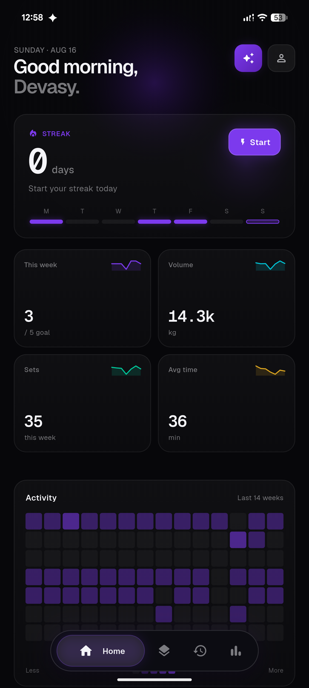
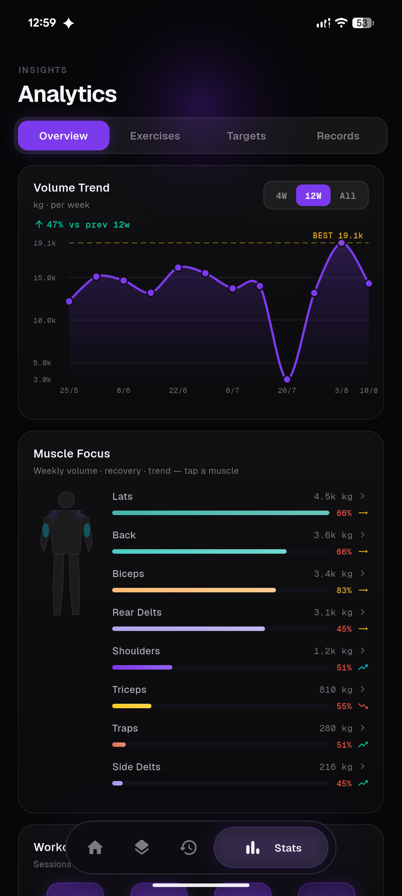
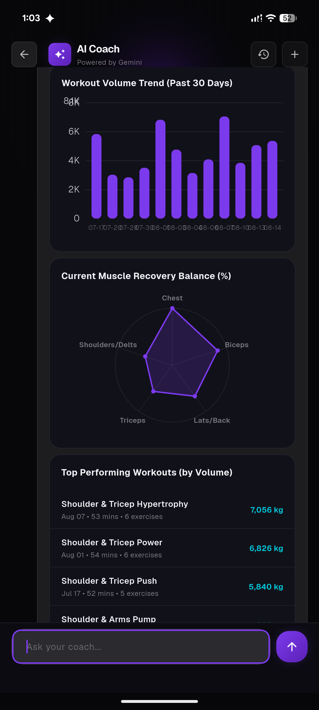
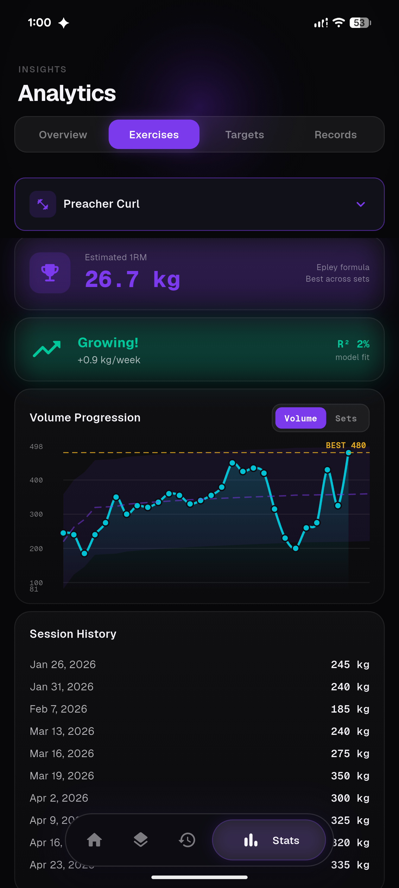
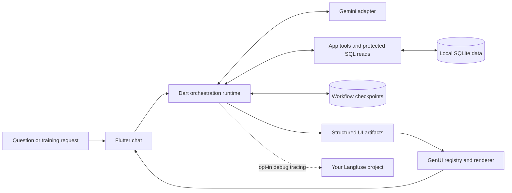

<div align="center">
  <h1>RepForge</h1>
  <p><strong>Track your training. Understand your progress. Ask better questions.</strong></p>
  <p>An open-source Android workout logger with an AI coach that can work with your actual training data.</p>
  <p>
    <a href="https://f-droid.org/en/packages/com.devasy.repforge/">Get it on F-Droid</a> ·
    <a href="https://play.google.com/store/apps/details?id=com.devasy.repforge">Google Play</a> ·
    <a href="https://github.com/Devasy/RepForge/releases/latest">Download an APK</a>
  </p>
  <p>
    <a href="https://github.com/Devasy/RepForge/releases"></a>
    <a href="https://flutter.dev/"></a>
    <a href="LICENSE"></a>
    <a href="https://github.com/Devasy/RepForge/stargazers"></a>
  </p>
</div>

**Here to train?** [See what the app does](#your-training-in-one-place). **Here to build?** [Explore the reusable AI layers](#build-with-the-parts-you-need).

## Your training, in one place

RepForge helps you record what you did, see what changed, and decide what to do next. Log a gym session, follow a routine, track a timed or bodyweight exercise, and review your history without an account. Your workout log, routines, and standard analytics work offline.

| What you want to do | How RepForge helps |
| --- | --- |
| Get through a workout without fighting the app | Log sets, reps, weights, holds, dropsets, and rest periods in an active workout flow. |
| Know whether you are progressing | Review exercise trends, estimated 1RM, personal records, volume, and muscle-group training exposure. |
| Keep a plan you can actually follow | Build routines and multi-week training programs, then use your saved history to guide progression. |
| Bring health and training together | Connect Android Health Connect for supported workout and health data, including sleep and heart-rate context. Availability depends on permissions and your data sources. |
| Understand your own records | Ask the optional Gemini coach to retrieve training history, investigate a trend, and present an explanation or chart. |
| Keep control of your data | Store records on-device and export/import backups. AI features are optional and require your own API key. |

### See it in action

<p align="center">
  
  
  
</p>
<p align="center">
  
  
  
</p>

### A coach with access to the evidence

Try questions such as:

- “Compare my squat progress over the last three months.”
- “My training volume went up. Did my top sets improve too?”
- “Show my sleep alongside my workouts for the last month.”
- “Build a three-day program around my equipment and recent training.”

The coach can discover your logged exercises, retrieve workouts and performance, and use schema-aware SQL for comparisons that need joins or exact set-level checks. It can then turn results into charts, metric cards, and other structured views inside the conversation. Creating or following a training program goes through an explicit approval step.

Its analysis can span relevant workout and health tables rather than being limited to a short chat summary. **Database access is read-only and scoped:** queries run on a separate connection, results are capped, and settings, conversations, and orchestration tables are restricted. Missing records remain missing; wearable readings and recovery scores are estimates. AI answers can be wrong and need checking against the underlying records.

### Install

- **[F-Droid](https://f-droid.org/en/packages/com.devasy.repforge/)** — install through the F-Droid client for updates.
- **[Google Play](https://play.google.com/store/apps/details?id=com.devasy.repforge)** — availability depends on your region and testing/rollout access.
- **[GitHub Releases](https://github.com/Devasy/RepForge/releases/latest)** — download a release APK directly.

Store versions can differ while builds and reviews complete. Check the listing for the version available to you. See the [changelog](CHANGELOG.md) for release history.

## Build with the parts you need

RepForge is also a working example of a Flutter app that combines durable AI workflows, local database tools, generated UI, and developer tracing. You can reuse the orchestration packages without adopting a fitness app or its data model.

| Layer | What you can reuse | Where to start |
| --- | --- | --- |
| **Agent orchestration** | A pure Dart model/tool loop and typed workflow graphs, checkpoints, interrupts, cancellation, execution budgets, and tool authorization. | [`ai_orchestration`](packages/ai_orchestration/README.md) |
| **SQLite persistence** | Durable workflow checkpoints, revision checks, operation deduplication, and named parameterized read tools. | [`ai_orchestration_sqlite`](packages/ai_orchestration_sqlite/README.md) |
| **Flutter integration** | Observable agent state, attach/restore/detach lifecycle, pending input, approval widgets, and an artifact renderer registry. | [`ai_orchestration_flutter`](packages/ai_orchestration_flutter/README.md) |
| **Gemini adapter** | REST streaming, tool-call correlation, continuation/signature preservation, usage reporting, cancellation, and bounded request retry/fallback. | [`ai_orchestration_gemini`](packages/ai_orchestration_gemini/README.md) |
| **Generative UI** | A component registry, parser, prompt vocabulary, theme tokens, and Flutter renderer for model-produced JSON. | [`lib/genui/a2ui.dart`](workout-logger/lib/genui/a2ui.dart) |
| **Database-aware coach** | An integration reference for domain tools, schema-aware SQL, evidence-oriented instructions, and approved writes. | [Coach tools](workout-logger/lib/services/ai/coach_tool_service.dart) · [SQL service](workout-logger/lib/services/ai/sql_query_service.dart) |
| **Langfuse observability** | An app-level reference for correlated agent/model/tool spans, usage, failures, redaction, and optional content capture. | [Tracing implementation](workout-logger/lib/services/ai/observability/agent_tracing.dart) · [Exporter](workout-logger/lib/services/ai/observability/langfuse_service.dart) |

The four orchestration packages are private **0.1.0** packages used through local path dependencies while their APIs settle; they are not published pub.dev releases. The core, SQLite, and Gemini packages are pure Dart. Only the Flutter bridge requires Flutter. All inherit the repository's Apache-2.0 license. Start with the [package guide](packages/README.md) for boundaries and independent verification commands.

### How the pieces fit



The host app owns prompts, credentials, domain tools, and approval decisions. The runtime owns workflow execution. Checkpoint storage is separate from the tools that query application data. Generated UI is rendered locally from registered components.

### Start with orchestration

Clone this repository and use a sibling package as a path dependency. For an application beside `packages/`:

```yaml
dependencies:
  ai_orchestration:
    path: ../packages/ai_orchestration
```

Supply your own model provider, tools, workflow, checkpoint store, and authorization policy. Add the Gemini, SQLite, or Flutter package when you need that integration. The [core README](packages/ai_orchestration/README.md) includes a minimal model/tool workflow and explains resume, cancellation, approval, and execution limits.

To explore without API credentials, run the examples from the repository root:

```sh
cd packages/ai_orchestration
dart pub get
dart run example/expense_agent.dart

cd ../ai_orchestration_sqlite
dart pub get
dart run example/task_assistant.dart
```

These examples use scripted providers to demonstrate execution, user input, database reads, and persisted state. They do not call or evaluate a live model. See the [Flutter example](packages/ai_orchestration_flutter/example/main.dart) for controller and approval UI integration.

### Reuse GenUI in another Flutter app

The [GenUI module](workout-logger/lib/genui/) lives inside the app source; it is not a standalone package. Its public entry point is `a2ui.dart`. To adapt it, bring the module and its Flutter, `material_ui`, and `fl_chart` dependencies into your app, then provide your theme and component vocabulary.

The same registry drives component parsing, rendering, and the instructions sent to the model. Built-in components include grids, statistic cards, charts, data lists, gauges, scatter plots, radar charts, and filter chips. Add a component specification to extend that vocabulary.

```dart
final parser = A2UiParser(defaultA2UiRegistry);
final node = parser.parse(modelResponseText);
// When node is non-null, render with A2UiRenderer(node: node).
// Otherwise, display the response as ordinary text.
```

The renderer does not execute model-generated Dart or fetch data. Your application retrieves data through tools and decides which components it supports. See the [registry](workout-logger/lib/genui/src/default_registry.dart), [renderer](workout-logger/lib/genui/src/a2ui_renderer.dart), and [GenUI tests](workout-logger/test/genui/) for extension examples and validation behavior.

### Learn from the coach's database tools

The app combines ordinary domain queries with [`run_sql_query`](workout-logger/lib/services/ai/coach_tool_service.dart) for questions that need a custom comparison. Its [coach instructions](workout-logger/lib/services/ai/coach_instructions.dart) cover date windows, units, missing data, actual observed sets, and the difference between correlation and causation.

For a different domain, supply your own schema and access rules. The reusable SQLite package provides **application-owned parameterized SELECT templates**. RepForge's model-written SQL service is a separate, app-specific implementation; it is not a general-purpose database sandbox. The runtime's tool policy and the app's write tools handle approved changes separately from SQL reads.

### Inspect agent behavior with Langfuse

In a **debug build**, open **Profile → Developer features → Langfuse**, configure your project's HTTPS host and keys, and enable tracing. The integration records related agent turns, model generations, and tool calls, with usage and failure information. Credentials are stored through secure storage; tracing is off by default and runtime exports are gated to debug mode.

Prompt/reply/tool-result capture has a separate opt-in switch and is off by default. Enabling it can send workout or health data, including SQL and tool results, to your Langfuse project. Redaction is not anonymization. This is developer tooling rather than background tracing in release builds.

The [implementation](workout-logger/lib/services/ai/observability/) and [tests](workout-logger/test/langfuse_test.dart) are useful integration references. They remain coupled to RepForge's settings and logging infrastructure rather than being another extracted orchestration package.

## Privacy and optional network features

Workout logging, routines, and standard analytics work locally. The optional AI coach and AI planning features send the conversation and relevant context/tool results to Google's Gemini API when you configure your own key. Provider pricing and quotas apply. The optional AI network dependency is disclosed in the [F-Droid listing](https://f-droid.org/en/packages/com.devasy.repforge/).

Health Connect access depends on the permissions you grant. Developer Langfuse tracing is a separate opt-in integration with the content-capture controls described above. Review what you share before enabling either integration.

## Run RepForge locally

Use **Flutter 3.50.0 stable**, including **Dart 3.14.0**, plus Android development tools and a device or emulator. The SDK pin lives in [`pubspec.yaml`](workout-logger/pubspec.yaml) and is used by CI and F-Droid builds.

```sh
git clone https://github.com/Devasy/RepForge.git
cd RepForge/workout-logger
flutter pub get
flutter run
```

From `workout-logger/`, validate app changes with:

```sh
dart format --output=none --set-exit-if-changed .
flutter analyze
flutter test
```

Build APKs with `flutter build apk --release --split-per-abi`, or a Play bundle with `flutter build appbundle --release`. Production signing requires your own configuration. APKs are written under `build/app/outputs/flutter-apk/`.

### Find your way around

| Directory | Contents |
| --- | --- |
| [`workout-logger/`](workout-logger/) | Flutter app, domain logic, tests, and release tooling. |
| [`packages/`](packages/) | Reusable AI orchestration packages and examples. |
| [`workout-logger/lib/genui/`](workout-logger/lib/genui/) | Registry-based generated UI module. |
| [`fastlane/`](fastlane/) and [`fdroid/`](fdroid/) | Store metadata, screenshots, and F-Droid build configuration. |
| [`.github/workflows/`](.github/workflows/) | CI and release automation. |

Python 3 is used for release-note and release-readiness checks. The app does not need a Python server or the retired analytics dashboard.

## Contribute or reuse

Building another assistant? Start with the [orchestration examples](packages/README.md). Building an AI-driven Flutter interface? Explore the GenUI registry. Improving a workout app? Look through the [issues](https://github.com/Devasy/RepForge/issues) or suggest a concrete workflow that RepForge could handle better.

Open a focused PR with the relevant tests and a short explanation of the resulting behavior. For app-facing changes, follow the [changelog format](docs/changelog-format.md). For reusable package changes, keep RepForge models, prompts, credentials, and screens out of the package boundary.

RepForge and the extracted packages are licensed under [Apache 2.0](LICENSE). Preserve the license and applicable notices when reusing code. If RepForge helps your training or your own project, a star or a shared example helps others find it.

Created by [Devasy Patel](https://github.com/Devasy) · [Report an issue](https://github.com/Devasy/RepForge/issues)
