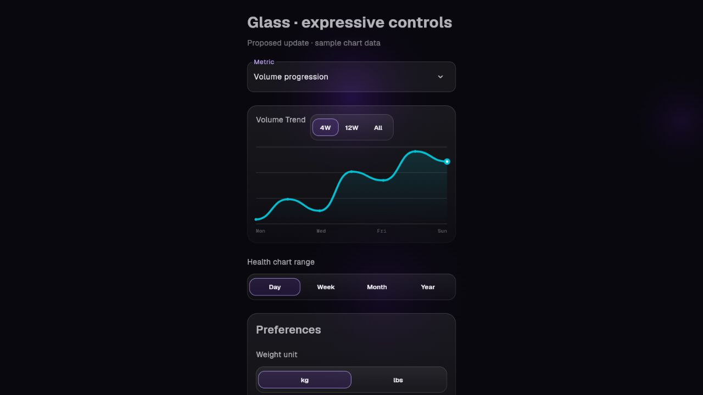
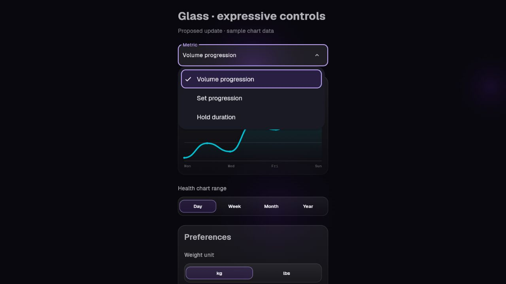

# Glass controls and analytics

The r2.2.2 controls update keeps RepForge's glass surfaces, Geist typography,
violet interaction accent and cyan data accent. Material 3 Expressive informs
clear grouping and stronger rounded chart marks; it does not replace this palette.

References inspected:
- ADNS: https://github.com/eyalm2000/adns/blob/master/app/src/main/java/com/eyalm/adns/ui/components/WavyLineChart.kt
  Rounded data strokes and restrained grid scaffolding.
- Essentials: https://github.com/sameerasw/essentials/blob/main/app/src/main/java/com/sameerasw/essentials/ui/core/pickers/SegmentedPicker.kt
  A containing surface connects related choices; label styling and padding are configurable.
- Existing project DESIGN.md and docs/design-md-refs in the original checkout.

RFSelectionGroup provides compact and expanded sizing independently. Chart
headers use compact, intrinsic-width tracks; form choices retain available-width
layout. Explicit widths bypass LayoutBuilder for intrinsic-height workout layouts.
Selected options retain accessible semantics and keyboard activation. Shapes and
label positions remain stable when selection changes.

RFDropdown uses compact glass fields by default, with a standard-density option.
Its menu retains an opaque elevated surface for reading over the underlying chart.

Charts share stroke, grid, area and tooltip tokens. Plot heights, datasets,
aggregation, units and domain calculations are unchanged. Tooltips in fl_chart
stay inside plot bounds. No chart package or runtime dependency was added.

Visual verification uses an isolated Flutter web harness with actual shared
components and explicitly labelled sample data. It is not a full-app web port.
Regression tests cover compact headers, large text, keyboard selection, disabled
controls, saved dropdown values, chart interactions and workout input layouts.

## Flutter component preview

Sample data is used only in this preview harness.

## Validation

- Full Flutter suite: 1,348 tests passed.
- Compact chart density: 320dp at normal and doubled text scales.
- Existing keyboard, disabled, saved-value and chart interaction coverage passed.
- Changed production files have no analysis errors or warnings; health_bar_chart.dart retains one pre-existing informational trailing-comma lint.
- Flutter web component preview compiled and was visually inspected, including the open dropdown.
- The design detector reported no findings; Flutter widget tests and visual inspection provide the relevant checks for Dart UI.
