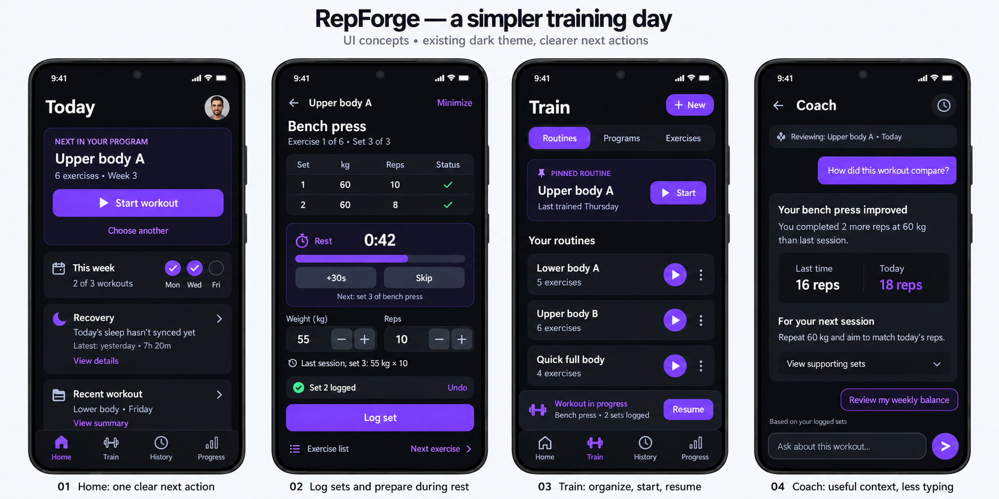
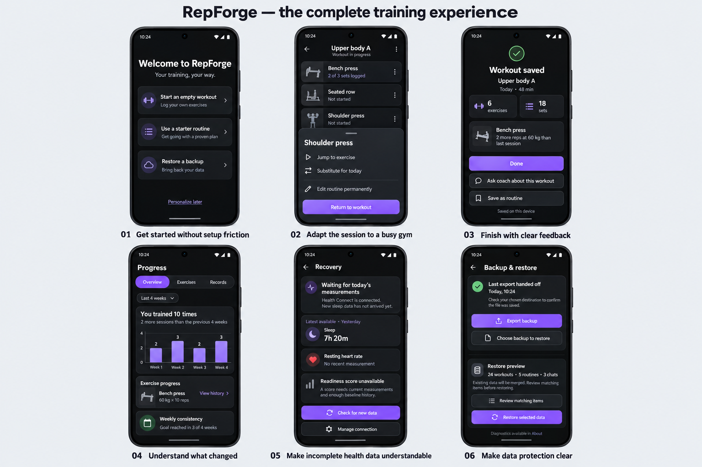
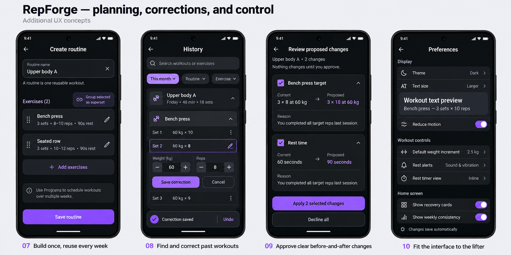

# RepForge UX revamp: design handoff

Prepared 2026-10-25. This branch contains analysis and mockups only; it does not change app behavior.

## Start here

- [UX analysis and implementation roadmap](ANALYSIS.md)
- [Copyable prompt for the next session](HANDOFF.md)
- [Mockup inventory and interpretation](mockups/README.md)

## Mockup boards

### Core daily flows

### Supporting training flows

### Planning and control

## User decisions and current status

The user confirmed that previous chats are accessible after the 2.2.1 fix. Retain diagnostic logging. They liked the UX recommendations and visual direction, explicitly chose mockups for the remaining improvements, and requested this branch with the analysis and a next-session handoff. Implementation has not been authorized by this save request; the next session should follow its new task instruction.

The branch starts from main at `a2af623` (merged PR #93). It is a normal design branch, not a release branch. No version bump, release, or PR is part of this handoff task.
